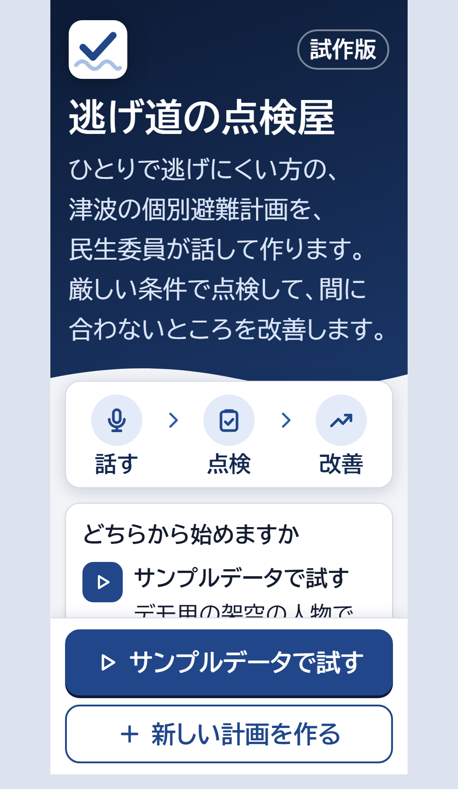
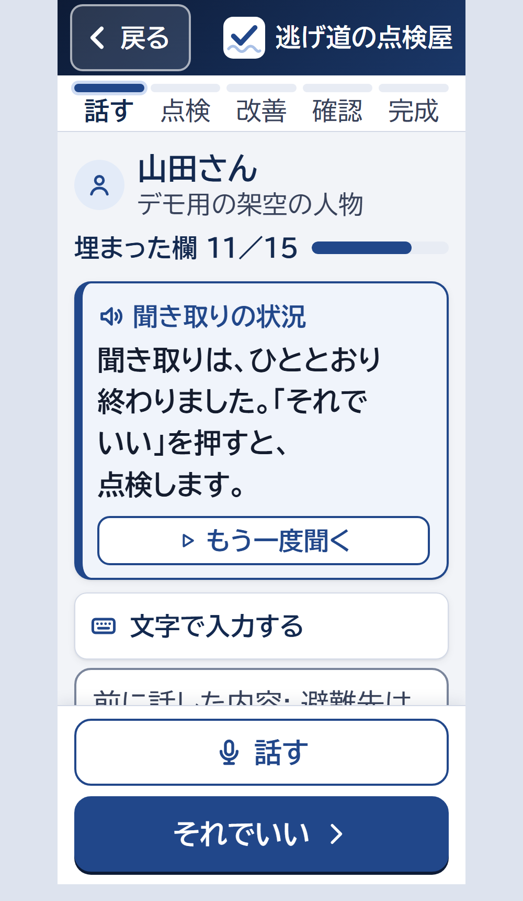
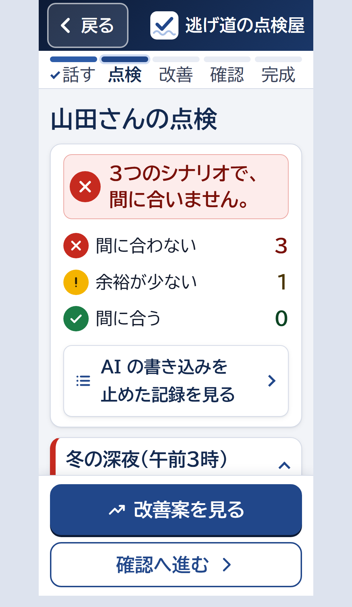
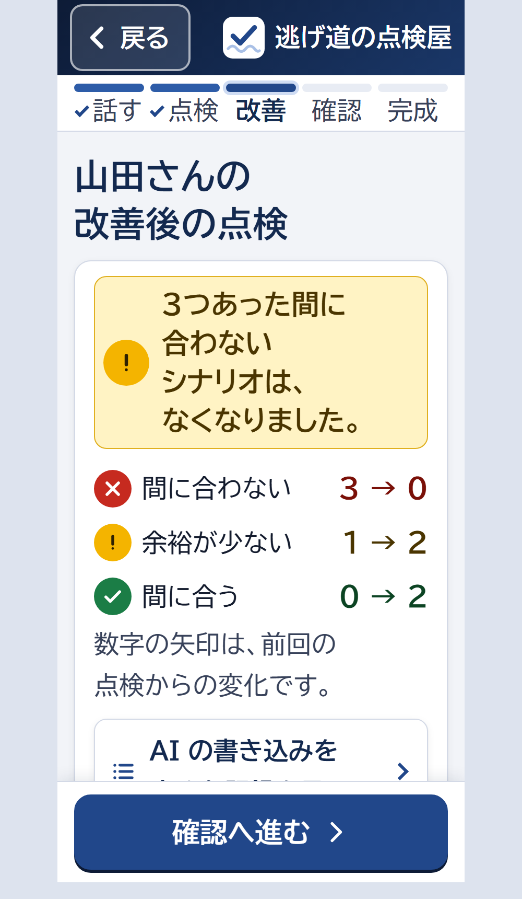

# 逃げ道の点検屋（EscapeCheck）

**民生委員が対話で個別避難計画を作成し、防災の知見に基づいて第三者の視点で抜け漏れを点検し、改善案を示す音声アプリ**

- テーマ: テーマ2「本来、誰にでも届くべきものを。」（Built with Claude: Japan 2026）
- デモ動画（3分）: （提出時に記載）
- 作品の中の Claude: Claude Agent SDK（聞き取り・レッドチーム・検証の3つのエージェント、Skills、自作の MCP ツール、フック）
- 開発: Claude Code（並列セッション、サブエージェント、プロジェクトの Skills、フック）

## プロジェクト概要

このプロジェクトは、一人では避難できない高齢者の個別避難計画づくりを手伝う民生委員の「防災の専門家ではないため、要支援者が抱える問題を適切に把握し、実行できる計画を立てるのが難しい」という課題を、対話形式による計画作成、防災の知見に基づく第三者視点の抜け漏れチェック、改善案の作成によって解消する音声アプリです。

個別避難計画の作成率は避難行動要支援者名簿の登載者の15.1%にとどまります（2026年4月）。避難計画作成をサポートする民生委員は、高齢者の割合が高く、IT活用も進まない状況です。当プロジェクトはそんな民生委員の祖母を手助けしたいという思いから企画されました。

利用場面: 民生委員が訪問先で「夜は1階で寝ゆう。耳が遠うて放送は聞こえん」とヒアリング内容をアプリに話すと、Claude が計画に必要な回答項目を自動で埋め、足りない項目はアプリが質問を読み上げます。ヒアリングが完了すると、Claude が話から要支援者固有の問題も察知し、「冬の午前3時」「支援する人が来られない夜」など様々な条件で点検します。民生委員と本人が改善案を選ぶと計画を改善し、すぐ利用可能にします。

## 画面

| ホーム | 聞き取り | 点検の結果 | 改善のあと |
|---|---|---|---|
|  |  |  |  |

画面は、サンプルデータ（架空の山田さん）で撮影した。数値はサンプルの値。公共機関が配るアプリを想定し、藍を基調色にした。判定は安全色の考え方（間に合う＝緑、余裕が少ない＝黄、間に合わない＝赤）に、記号と文字を必ず添える。文字は UD フォントを優先し、本文は 24px 以上、ボタンの高さは 64px 以上、1画面の操作は2つまで。

## 誰に、何が届いていないか

個別避難計画は、災害のときに一人では避難できない人について、誰が、どこへ、どの道で、どう支援して避難するかを決めておく計画です。市町村が作り、地域では民生委員などが本人の話を聞いて作成を手伝います。

| 届いていない理由（壁） | 今のやり方 | この作品 |
|---|---|---|
| 防災の知見: 避難が間に合うかの計算と、厳しい条件での確認 | 紙の様式とハザードマップを見比べる。作った計画を、真夜中や冬の条件で試す手段が無い | 間に合うかはコードが計算し、レッドチームエージェントがシナリオを選んで点検する |
| IT: 入力の手間 | 様式に手で書く。スマートフォンの操作が苦手な人が多い | 話すだけ。土佐弁のままでよい。大きな文字とボタン |
| 人手: 担い手の不足 | 民生委員は全国で約2万人足りない（2025年12月の改選で、定数 240,971人に対し委嘱 220,880人。厚生労働省） | 聞き取りから完成までを1回の訪問で終えられる長さにする（試験では約7分） |

作者の祖母は、高知県土佐市の民生委員（70代後半）です。土佐市の宇佐などの沿岸は、南海トラフ地震の津波が短い時間で到達する地域です。スマートフォンが苦手な民生委員でも使える形を目指しました。

## できること

| 段階 | すること | 担当 |
|---|---|---|
| 1. 話す | 民生委員が、担当する人のことを話す。聞き取りエージェントが、市の様式の欄に入れ、すべての欄に出典（発言の原文）を付ける。足りない欄は、決まった質問の文で聞く（質問は合成音声で読み上げる） | 民生委員、Claude |
| 2. 調べる | 自宅と避難先の浸水深・津波到達時間・標高・距離を、国と県のデータから取り出す | コード |
| 3. 点検する | 「冬の午前3時」「平日の昼に家族がいない」「道がふさがる」「放送が聞こえない」「避難支援者も間に合わない」などのシナリオで、避難が間に合うかを計算し、何分足りないかを示す | Claude（シナリオと説明）、コード（数値） |
| 4. 改善する | 改善案（耳が遠い人には光や振動で知らせる機器を枕元に置く、避難先を変える、声かけを頼んでおく、寝る場所を玄関の近くにする など）を、短縮される分数つきで示す。危険な案（浸水が想定される自宅の2階、車での避難、様子を見る）は出さない | Claude（案）、コード（効き目と安全の確認） |
| 5. 決める | 民生委員と本人が改善案を選ぶ。選ぶと、もう一度点検する | 人 |
| 6. 確認・完成 | 検証エージェントが、計画と出典の食い違いを見直す。民生委員が確定し、市の様式と、本人用の大きな文字の避難カードを印刷する | Claude、人 |

避難を判断するのは、本人・家族・民生委員・市です。この作品は、計画を話し合うための「たたき台」を作ります。

## Claude の使い方

### 作品の中（Claude Agent SDK）

| エージェント | モデル | すること | 選んだ理由 |
|---|---|---|---|
| 聞き取りエージェント | claude-sonnet-5-5 | 文字起こしを様式の欄に入れる。土佐弁の意味をくみ取り、引用は原文のまま残す | 1件 約6秒・約0.02ドル。土佐弁の評価では Haiku（Skill あり）も同じ正答率だったが、Haiku は欄の値を土佐弁のまま書くことがあり（「目がよう見えん」）、評価の件数も少ないため Sonnet にした |
| レッドチームエージェント | claude-opus-5-5 | 計画に合うシナリオを選び、計算ツールで確かめ、問題点と改善案を書く | ツールを何十回も呼び、話の中だけにある条件から問題点を見つける長い推論が要る（1件 約45秒・約0.27ドル） |
| 検証エージェント | claude-sonnet-5-5（別のセッション） | 完成の前に、計画と出典の食い違いを見直す | 計画を作ったエージェントとは別のセッションで見直す |

- **Skills**（作品のエージェントが読む）: 個別避難計画の様式の書き方（kobetsu-plan-form）、点検のシナリオと問題点の種類（red-team-scenarios）、土佐弁の意味と音声認識の聞き違い（tosa-ben）、民生委員と高齢者に向けたやさしい言葉（yasashii-kotoba）
- **自作の MCP ツール**: 計画の読み書き（plan.set_fields、plan.add_premise、plan.add_finding、plan.propose_fix など）、地理の事実（hazard.get_facts、hazard.find_shelters）、計算（sim.run_scenario、sim.try_fix）。エージェントには、組み込みのツール（コマンドの実行、ファイルの操作、Web の取得）を持たせない
- **フック**: エージェントがツールを使う前に、コードで確かめて拒否する。発言の原文に無い引用、出典の無い記入、説明文に直接書いた数値（数値はコードが入れる）、効き目の無い改善案と危険な改善案、人の承認の無い変更。すべての呼び出しと拒否は監査ログに残り、画面の「記録」で見られる
- **数値はコード、説明は Claude、決めるのは人**: 浸水深・到達時間・距離・所要時間・余裕時間は、すべて `tools/` のコードが出す。Claude は数値を作らない

### 開発（Claude Code）

- **並列セッション**: 計算・地理・データ、エージェントとサーバー、画面、説明のアニメーションを、別々のセッション（git worktree）で並行して作り、主セッションが統合してテストした
- **サブエージェント**: 審査員エージェントが、画面や台本を4つの審査基準で採点し、得点が上がる改善の順位を出した（例: 画面のデモの観点 52/100 から、誰のどの話から何を見つけたかを画面に出す修正へ）
- **プロジェクトの Skills**（開発用）: 審査基準での見直し、開発の記録、デモ動画、提出物の4つ
- **フック**（開発用）: ファイルを編集したら単体テストを実行する。コミットの前に、API キーなどの秘密情報と、ダウンロードした元データが入っていないかを確かめる
- **MCP の再利用**: 作品のエージェントと同じ MCP ツール（地理の事実と計算）を、開発中の Claude Code からも呼べるようにした（`.mcp.json`）
- **評価の自動実行**: 点検の評価（`eval/run_eval.py`）と土佐弁の聞き取りの評価（`eval/run_dialect_eval.py`）。正解は実行の前に固定してコミットした
- **合成音声**: 民生委員役の答え、アプリの質問、デモ動画のナレーションを、ElevenLabs の音声合成で作った（`scripts/make_voice.py`）

## 評価

### 点検の評価（仕込んだ問題点16件）

架空の人物の計画16件に問題点を1つずつ仕込み、見つけられるかを測った。4件は、様式の欄ではなく、聞き取りの話の中にだけ問題点がある（例: 「耳が遠うて、放送は聞こえんがよ」）。4件は、調整に使わないホールドアウト（評価専用）にした。

| 流れ | 見つけた問題点 | うち話の中にだけある問題点 | ホールドアウト | 危険な改善案 |
|---|---|---|---|---|
| ルールベースのベースライン（様式の欄だけを見る） | 12/16 | 0/4 | 2/4 | ―（改善案を出さない） |
| Claude（v2-final。ホールドアウトを初めて実行した版） | 15/16 | 3/4 | 3/4 | 0/3 |
| Claude（v3。耳が遠い人への改善案を追加した版） | 16/16 | 4/4 | 4/4 | 0/3 |

様式の欄にある問題点はどちらも見つけられ、話の中にだけある問題点は Claude だけが見つけた。

- 推移（調整用の12件）: v1 9/12・10/12（同じ版を2回実行して1件の差）→ v2 12/12。v1 の見逃し（自宅の2階への避難、車での避難）は、レッドチームの Skill を直して検出した
- 誤検出（正解にも、計算で成り立つことを確かめた副次的な問題点にも無い種類の指摘）: ベースライン 0、Claude 18（v2-final）・19（v3）。主に「余裕が3分以内」の指摘と、問題点の種類の付け方の違いv2-final で見逃した1件は、説明の文では「放送に気づけない」に触れたが、問題点の種類を付けなかったもの。v3 は、デモの流れの確認で見つけた不足（耳が遠い人への改善案が無い）を直した版で、ホールドアウトは2回目の実行のため、評価専用の値としては v2-final の 3/4 のほうが確か。

### 土佐弁の聞き取りの評価（15件・確認28か所）

| モデル | 土佐弁の Skill 有り | 土佐弁の Skill 無し |
|---|---|---|
| claude-sonnet-5-5 | 100% | 100% |
| claude-haiku-5-5 | 100% | 96%（話していない歩行速度を推測で記入した） |

### 合成音声での音声入力の試験

民生委員役の土佐弁の答え（合成音声）を、アプリの音声入力（Chrome の音声認識）で聞き取り、点検・改善・完成まで通した（架空の山田さん）。

- 1人分（話し始めてから計画の完成まで）: 約6分50秒。Claude の費用は約0.42ドル
- 文字起こしの誤り: 157字中 18字（11%）。ほとんどが土佐弁の語尾（「寝ゆう」→「寝よう」、「〜き」→「気」）。「杖ついちゅう」は「ついつい中」になり、杖が消えた。消えた欄は、アプリが追加の質問で聞き直した
- 入らなかった欄（避難支援の方法。「声かけてくれゆう」→「くれよ」）は、土佐弁の Skill に音声認識の聞き違いの表を足して直した。この文字起こしを評価データセット（`eval/dialect_cases/asr_cases.json`）にして測り、記入できた回数が 0/6 から 7/7 になった。消えた語（杖）を推測で補うことは、前も後も 0回だった

## 動作手順

必要なもの: Python 3.14、[uv](https://docs.astral.sh/uv/)、Chrome、Claude の API キー

```bash
uv sync
.venv/Scripts/python.exe -m unittest discover -s tests
```

サーバーを起動する（API キーは環境変数 `ESCAPECHECK_ANTHROPIC_API_KEY` か `ANTHROPIC_API_KEY` に入れる。合言葉は環境変数 `ESCAPECHECK_PASSPHRASE` に入れるか、起動したときに入力する）。

```bash
.venv/Scripts/python.exe -m app.server
```

Chrome で `http://localhost:8000/` を開き、合言葉を入れて「サンプルデータで試す」を選ぶ（サンプルの人物はすべて架空）。macOS と Linux では `.venv/bin/python` を使う。

API キーが無くても、画面だけはサンプルデータで動かせる。

```bash
.venv/Scripts/python.exe -m http.server 8765 --bind 127.0.0.1 --directory web
```

`http://localhost:8765/?mock=1` を開く。

## 安全・個人情報・限界

- サンプルデータの人物は、すべて架空。実在の要支援者の情報は使っていない
- 氏名・電話番号・座標は Claude に送らない（「Aさん」のように仮名にする）。民生委員には守秘義務がある（民生委員法第15条）
- 音声入力は、ブラウザの音声認識を使うため、音声が Google（Chrome）や Apple（Safari）のサーバーに送られる。実在の人で使う前に、音声認識の差し替えと、市の了解が必要
- 計算は、歩行速度や避難開始時間の仮定を置いた概算。距離は直線距離に係数を掛けた概算で、道路のデータは使っていない。仮定は画面にすべて表示する
- 津波到達時間は、高知県の2012年の予測（土佐市の津波浸水予測時間図）を使う。2025年の新しい予測には、土佐市の地点の値が無かった。画面には使った版を表示し、短いほうの値で点検する
- 揺れたら、すぐ高い場所へ避難してください。市の情報に従ってください

## データの出典

国土地理院（地理院タイル、指定緊急避難場所データ、標高 API）、ハザードマップポータルサイト（津波浸水想定。高知県）、国土交通省 国土数値情報（津波浸水想定）、土佐市（津波浸水予測時間図）。加工の内容と、各規約が求める出典の書き方は [data/README.md](data/README.md)。使っているライブラリとライセンスは [THIRD_PARTY_NOTICES.md](THIRD_PARTY_NOTICES.md)。

## 期間中に作ったことの記録

すべてのコードと文書は、ハッカソンの期間中に作った。最初のコミットは 2026-11-07 17:59（日本時間）。試行錯誤の主なもの:

- 作者の祖母に電話で試してもらう予定だったが、締切までの日程が合わず、民生委員役の答えを合成音声で作って試験した
- 追加の質問の文を、エージェントが作る文から、確認した決まった文に変えた（質問の言い方が毎回変わり、読み上げで誤りやすかったため）
- 評価の判定のコードの誤り（正しい答え「よく聞こえない」を誤りと判定する、引用の中の危険な文を数える）を見つけて直し、記録した結果から採点し直した
- 音声認識の聞き違いで入らなかった欄を、Skill に聞き違いの表を足して直し、評価で効き目を確かめた
- デモの流れを実物の Claude で通すと、耳が遠い人は、冬の深夜にどの改善案を選んでも「6分不足」のままだった（声をかける人が来るまで逃げ始められない計算のため）。改善案「光や振動で知らせる機器を枕元に置く」を加え、冬の午前3時は余裕1分、避難支援者が来られない夜は余裕9分になった。その途中で、「車いすは使わない」を「介助が必要」と判定する誤りも見つけて直した

## ハッカソンの後

この作品は、実在の民生委員や要支援者にはまだ使ってもらっていない（試験は架空の人物と合成音声で行った）。次の順に進めたいと考えている。

1. 作者の祖母（土佐市の民生委員）に、架空の人物のサンプルで画面を見てもらい、話し方・文字の大きさ・質問の言い方への意見を聞く
2. 市の了解を得て、土佐市の民生委員に見てもらう
3. 実在の人で使う前に、音声認識を、音声を外部に送らない方式に替え、個人情報の扱いを市と確認する

## ライセンス

MIT License（[LICENSE](LICENSE)）。使っているライブラリのライセンスは [THIRD_PARTY_NOTICES.md](THIRD_PARTY_NOTICES.md)。
